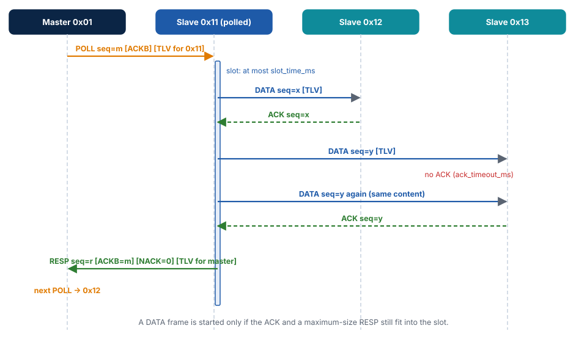
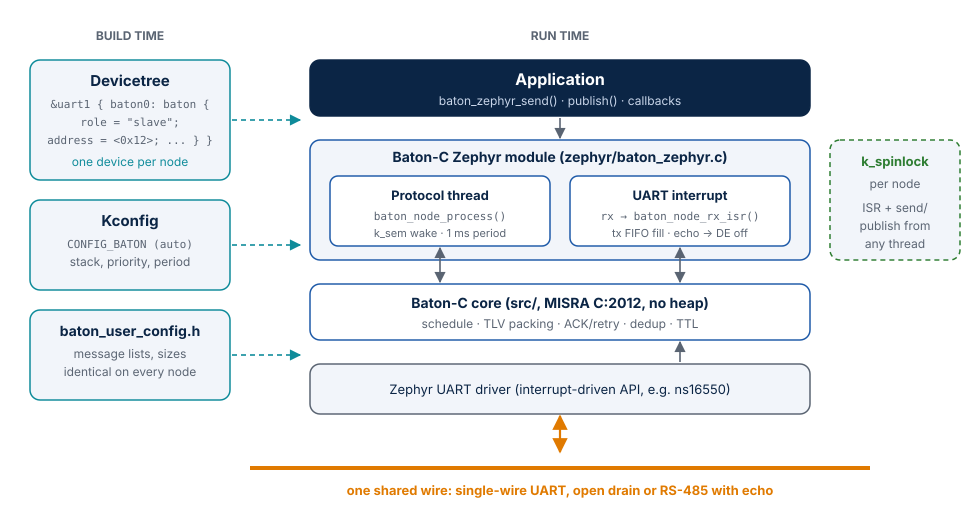
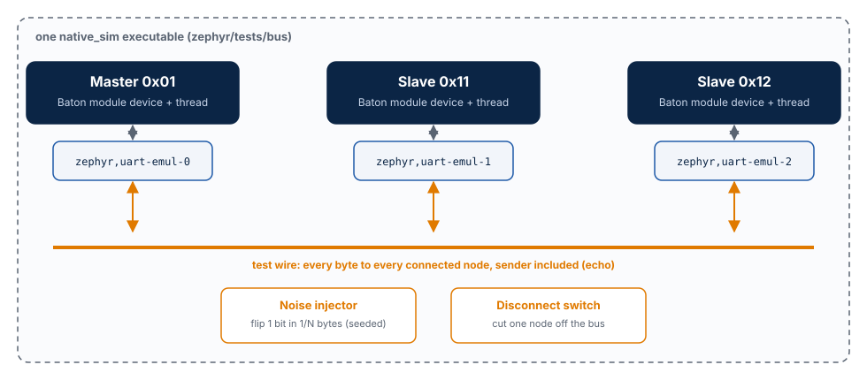

---
hide:
  - navigation
title: "One Wire, Many MCUs, No Lost Messages: Baton-C as a Zephyr Module"
description: >-
  How a deterministic single-wire UART bus written in MISRA C became a Zephyr module:
  devicetree binding, interrupt glue, a three-node bus test on native_sim with line noise,
  and the bring-up on a Microchip SmartFusion2 board.
---

# One wire, many MCUs, no lost messages

*Baton-C as a Zephyr module, from simulation to silicon.*

**Anton Vynohradov** · Embedded Systems Engineer, SystemFromScratch® · October 2026

!!! abstract "In short"
    [Baton-C](https://github.com/AntonVynohradov/Baton-C) is a small C11 library that turns
    one shared UART line into a deterministic bus: a master passes a token, *the baton*, to
    each slave in turn, so only one node ever transmits. Events arrive exactly once and in
    order; states always reach their latest value; every loss is reported. This article
    shows how the library became a **Zephyr module**: one line in a west manifest, one
    devicetree node, and the application only sends and receives. A complete three-node
    bus runs inside one `native_sim` image with injected line noise and a disconnected
    node. That is how the module is tested on every push, before any hardware is involved.

## The problem: one shared wire, no second chance

Put three or four microcontrollers in one device: a main controller, a motor driver, a
sensor board, a display. They need to talk, and the harness has room for one more wire.
A single-wire UART is the obvious choice: cheap, available on every MCU, good for a few
meters at 9600 bit/s. It is also unforgiving:

- **Collisions.** Two nodes transmitting at once destroy each other's bytes.
- **Noise.** A motor starts, a bit flips, a frame is garbage.
- **Dead nodes.** A board is unplugged in the field, and the others must keep working.
- **Lost commands.** A lost "stop" is not a statistic, it is a bug report.

The usual answers are a protocol stack that needs an operating system and a heap, or a
home-grown "send and hope" scheme. Baton-C sits in between: a protocol designed for small
MCUs that makes the guarantees explicit and testable.

## Baton in 60 seconds


- The **master** polls the slaves in a fixed order. A `POLL` frame grants the bus to one
  slave for one slot; the master also uses it to deliver its own messages.
- Inside its slot, the polled slave sends `DATA` frames to the master or to other slaves;
  each is acknowledged (`ACK`) frame by frame and retransmitted when needed. A `RESP`
  frame ends the slot and returns the bus.
- **Events** (commands, reports) are queued, acknowledged, deduplicated and delivered
  *exactly once, in order*. An event that cannot be delivered within its time-to-live is
  reported to the sender with the nodes that missed it.
- **States** (a temperature, an uptime) are mailboxes: the latest value always arrives,
  intermediate values may be skipped, and they can never overflow a queue.



Because only one node transmits at a time, the worst-case cycle can be computed from the
configuration. The library itself has no heap, no RTOS, no clock reads and no global
state, reports 0 violations of the Cppcheck MISRA C:2012 addon, and has 100 % line and
branch coverage in its unit tests. What it does *not* have is any knowledge of hardware:
the application feeds it received bytes, starts transmissions and calls
`baton_node_process()` every millisecond. On Zephyr, that glue is exactly what a module
should own.

## Why a Zephyr module, and not a driver

Baton is not a peripheral driver. It is a protocol stack on top of a UART, much like
Zephyr's own Modbus serial support. So it follows the same shape:

- **A west project.** The repository carries `zephyr/module.yml`; an application adds
  Baton-C to its manifest and nothing else.
- **A devicetree node under the UART** with compatible `systemfromscratch,baton`. The
  role, the addresses and the timing describe hardware topology, so they belong in
  devicetree. Every enabled node becomes a Zephyr device with its own protocol thread,
  so one image can serve several buses.
- **Kconfig** only for software choices: stack size, thread priority, processing period,
  log level. `CONFIG_BATON` turns itself on when a Baton node exists.
- **The library stays untouched.** The core sources in `src/` are compiled as they are;
  everything Zephyr-specific is one C file and one header in `zephyr/`.



For the application, this is the whole integration:

```yaml title="west.yml"
    - name: baton-c
      url: https://github.com/AntonVynohradov/Baton-C
      revision: v1.1.0
      path: modules/lib/baton-c
```

```dts title="boards/m2s010_mkr_kit_m2s010.overlay"
&uart1 {
	status = "okay";
	current-speed = <9600>;

	baton0: baton {
		compatible = "systemfromscratch,baton";
		role = "slave";
		address = <0x12>;
		master-address = <0x01>;
		slave-addresses = [11 12];
	};
};
```

```c title="src/main.c (shortened)"
static const struct device* const bus =
    DEVICE_DT_GET(DT_COMPAT_GET_ANY_STATUS_OKAY(systemfromscratch_baton));

static void on_message(void* context, uint8_t src, uint8_t msg_id,
                       const uint8_t* data, uint8_t length)
{
    if ((msg_id == BATON_MSG_CMD_SET_OUTPUT) && (length == 2U)) {
        /* drive the output, then confirm to the sender */
        (void) baton_zephyr_send(bus, src, BATON_MSG_OUTPUT_REPORT, data, 2U,
                                 BATON_PRIO_HIGH);
    }
}

int main(void)
{
    const struct baton_zephyr_callbacks callbacks = {.on_message = on_message};

    return baton_zephyr_start(bus, &callbacks);
}
```

No interrupt handler, no ring buffer, no thread, no lock in the application. Compare
that with the hand-written Zephyr example the library shipped before: about 200 lines of
UART interrupt code, critical sections and a polling thread, repeated in every project.

## Design decisions inside the module

**The echo ends the frame.** On a single wire, every node hears its own bytes. The
library already uses that echo to detect collisions; the module also uses the echo of
the last byte to know that the last stop bit has left the transceiver. That is the
moment to release an RS-485 driver enable (`de-gpios`) and it needs no "transmit
complete" interrupt. Those interrupts behave differently on almost every UART.

**One spinlock per node.** The UART interrupt and the library's critical-section hooks
take the same `k_spinlock`. `baton_zephyr_send()` and `baton_zephyr_publish()` are
therefore safe from any thread, on single-core and SMP systems alike.

**A thread that sleeps, but not too long.** Each node's thread runs
`baton_node_process()` and then waits on a semaphore with a 1 ms timeout. Received bytes
and new messages give the semaphore, so the node reacts immediately without
burning CPU while the bus is idle.

**Errors as errno.** The library's `BATON_ERR_*` codes become `-ENOBUFS`, `-EMSGSIZE`,
`-EADDRNOTAVAIL` and friends, so Zephyr code handles them like any other API.

**Fail the build, not the bus.** Baton times a 2 ms bus gap and a 5 ms inter-byte
timeout in milliseconds. While porting, it turned out that the board used for the
bring-up configures a 10 ms system tick, which would silently stretch every timeout
by up to a whole tick. The module now refuses to build with a tick coarser than 1 ms and
says which option to set. One `BUILD_ASSERT` replaces a debugging session in front of
an oscilloscope.

**Two Zephyr versions, one source.** Zephyr 4.5 changed the return type of
`uart_irq_update()` from `int` to `void`. The interrupt handler calls it as a statement,
so the same code builds on Zephyr 4.2 and on the current `main`.

## Testing a bus without a bus

A bus protocol is only as good as its behavior when things go wrong, and that is hard to
provoke on a bench on demand. So the first target of the module is not a board but
`native_sim`: Zephyr compiled as a Linux program.



The test image contains **three Baton nodes**: the master and two slaves, each a regular
device of the module on its own emulated UART (`zephyr,uart-emul`). A few lines of test
code join the three UARTs into one wire: every byte a node transmits reaches every
connected node, *including the sender*, just like the echo on a real single wire. The
wire can flip bits with a seeded random pattern and can disconnect a node. The module
under test is byte-for-byte the code that runs on the board.

| Test | What it proves |
| --- | --- |
| State reaches every node | A value published by one slave arrives at the master and the other slave, and not back at itself |
| Events, master to slave and slave to slave | 60 numbered events, each delivered exactly once and in order |
| Noisy line loses nothing | About 1 byte in 150 corrupted: retransmissions deliver all 200 events |
| Heavy noise: every loss is reported | About 1 byte in 40 corrupted: some events exceed their time-to-live, but none is duplicated or reordered, and every one that is not delivered is reported to its sender |
| Disconnected slave | The master reports the silent slave and the undeliverable event, the rest of the bus keeps working, and the slave is served again after it is reconnected |

The suite runs with five different noise patterns on every push (`west twister`, 40 of
40 test cases passing). The numbers from the run that this article quotes:

| Noise pattern | Moderate noise: corrupted bytes, CRC errors, events lost | Heavy noise, master→slave: delivered + reported lost | slave→master |
| --- | --- | --- | --- |
| default | 14, 20, **0 of 200** | 100 + 7 | 93 + 7 |
| seed 7 | 17, 28, **0 of 200** | 100 + 0 | 100 + 3 |
| seed 42 | 11, 18, **0 of 200** | 93 + 22 | 80 + 20 |
| seed 1234 | 20, 32, **0 of 200** | 84 + 42 | 62 + 42 |
| seed 31337 | 14, 24, **0 of 200** | 100 + 0 | 100 + 0 |

Two things are worth reading in that table. Under moderate noise nothing is lost:
corrupted frames fail their CRC and are retransmitted. Under heavy noise the protocol
does **not** pretend: events that miss their deadline are dropped *and reported*. The
sum "delivered + reported" is at least the number sent, and it can be higher, because
an event whose acknowledgement was destroyed is delivered and still reported as
unconfirmed. "No lost messages" means no *silent* loss: the application always knows.

All tables are generated from the twister reports by a script; the raw data is in the
[evidence](results.md).

## On silicon: Microchip SmartFusion2

The hardware target is the **Microchip M2S010 MKR Kit**: a SmartFusion2 SoC FPGA whose
microcontroller subsystem is an Arm Cortex-M3, clocked at 100 MHz in the board's
devicetree. I contributed the Zephyr support for this board; it ships with Zephyr 4.5. The module talks
to the bus through **MSS UART1** (the console stays on UART0); on SmartFusion2, which
pins that UART uses is decided by the FPGA design in Libero, so it is enabled by the
application's overlay, not by the board.

The firmware is built in a reproducible container, derived from my
[Zephyr SmartFusion2 workspace](https://github.com/AntonVynohradov/Zephyr-SmartFusion2-workspace):
the Zephyr SDK with only the Arm toolchain, west, and the Libero tools kept outside the
container.

| Item on Cortex-M3 (`-Os`) | Bytes |
| --- | --- |
| Baton-C library code (`src/`) | 5 986 |
| Zephyr module glue, with logging | 1 598 |
| Node state with the example message lists | 1 256 RAM |
| Protocol thread stack (configurable) | 1 024 RAM |
| Complete sample firmware: text / data / bss | 29 348 / 188 / 8 204 |

!!! note "Hardware measurements in progress"
    The sample builds without warnings for `m2s010_mkr_kit/m2s010` in CI. Bring-up on the
    board is in progress. This section will add the wiring, a logic-analyzer capture of
    one poll slot, the measured cycle time against the computed one, the measured
    thread stack usage, and the same fault-injection scenarios on a real wire.

## Reproduce it

Everything in this article is reproducible from the
[article repository](https://github.com/SystemFromScratch-Articles/Baton-C-One-wire-many-MCUs-no-lost-messages)
with a dev container or a local Zephyr setup:

```bash
west init -l article && west update -o=--depth=1 -n
article/scripts/test.sh            # bus test on native_sim + build for the board
python article/scripts/evidence.py # the tables of this article
```

See [Reproduce](reproduce.md) for the details.

## What's next

- **Hardware results** on the SmartFusion2 board, added to this page.
- **Upstream.** Baton-C is proposed to the Zephyr project as an *optional module*: a
  separate repository listed in Zephyr's optional manifest, with its samples and tests
  living in the module. The status is tracked on [Upstream](upstream.md).
- **RS-485 without echo.** Transceivers that disable their receiver while transmitting
  need a "transmit complete" path in the module; the core library supports them already.

If you build devices where several MCUs share one wire, I would like to hear how you
solve it today, and what Baton-C would need to fit your design.

---

[Baton-C on GitHub](https://github.com/AntonVynohradov/Baton-C) ·
[Documentation](https://antonvynohradov.github.io/Baton-C/) ·
[Zephyr module guide](https://antonvynohradov.github.io/Baton-C/zephyr/) ·
[LinkedIn](https://www.linkedin.com/in/vynohradov)
